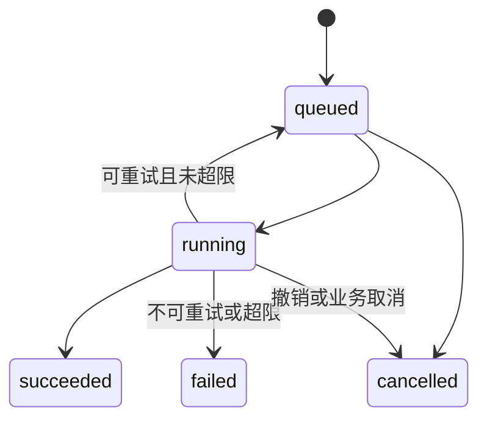
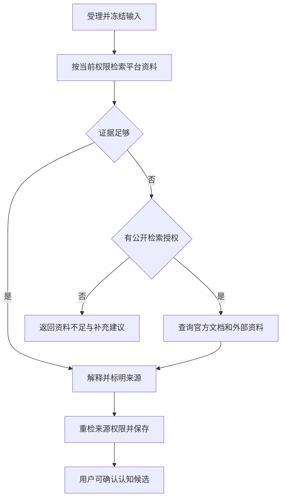

# 目标驱动的算法学习社区平台事务逻辑文档

版本 v1.0 ｜ 2026-10-08 ｜ 实现前设计

依据开题报告，配套 [接口文档](API.md)。本文包含业务流程、数据库事务边界、异步执行及失败处理。标注“本地事务”的内容必须同时提交或回滚；外部 API、模型生成和长任务均在事务外执行。

## 1. 模块和一致性

模块化单体包含认证、目标计划、知识检查、学习记录、社区、Agent、认知库、OJ、通知和审核。各模块拥有自己的数据，通过应用服务或事件协作，worker 可独立部署。

| 数据 | 一致性 | 约束 |
| --- | --- | --- |
| 归属、成员权限、授权、有效版本 | 强一致 | 当前数据库状态为准 |
| 提交、打卡、总结正文、认知确认 | 强一致 | 同事务写业务和 outbox |
| 进度快照、评分均值、索引、推荐 | 最终一致 | 可重建，带版本及计算时间 |
| 外部同步、模型结果 | 异步可失败 | 保存输入版本、来源和时间 |
| SSE | 至少一次提示 | 去重后查询实际资源 |

模型、互评和 OJ 都只提供证据。只有检查点规则服务判定能力通过。用户确认认知表示接受该版本，客观证据状态独立。

## 2. 公共事务机制

### 2.1 幂等和并发

鉴权后按用户、方法、路径、Idempotency-Key 查记录；相同摘要返回原结果，不同摘要 409。业务写入、outbox、幂等完成结果在同一事务提交。并发相同 key 用唯一约束竞争，失败请求读取既有结果。

更新使用 `UPDATE ... WHERE id=? AND version=?`，受影响行数为 0 返回 409。worker 落库同时校验业务、输入、计划和授权版本。外部生成结果不得用过期输入覆盖新状态。

### 2.2 异步任务

worker 租约领取，记录 locked_until、heartbeat、attempt_count；进程崩溃后可重领。结果写入前重检取消状态。带费用的模型调用超时不代表未执行，需预算核对和保守重试。

### 2.3 Outbox

业务事务插入 outbox_events：event_id、aggregate_id、aggregate_version、type、payload、occurred_at。dispatcher 成功投递后标记发送，崩溃可能重投，不能承诺恰好一次。

消费者同事务写 `(consumer_name,event_id)` 去重记录和业务变化。乱序处理：进度从当前事实重算；索引比较资源版本；提醒重检目标状态。不得使用迟到载荷覆盖新状态。

## 3. 学习目标、计划和每日任务

| 当前状态 | 操作 | 结果 |
| --- | --- | --- |
| draft | activate | 异步生成计划，成功后 active |
| active | pause | paused，不再安排新任务和催学提醒 |
| paused | resume | 重排成功后 active，不自动延长截止日期 |
| active | 系统检查完成条件 | completed，发送一次完成事件 |
| draft/active/paused/completed | archive | archived，历史只读 |

完成条件：当前计划全部必选检查点通过；打卡或平均分不能自动完成目标。模板没有必选检查点时禁止发布和激活。

### 3.1 激活

创建事务保存 goals=draft 和配置版本。activate 校验模板、前置依赖、截止日期和重复运行任务，写 job 与 outbox。worker 在事务外展开计划；落库事务锁定目标并重检版本，原子写 plan、stages、checkpoint_instances 并转 active。失败保持 draft，不显示半套计划。

### 3.2 重排

修改截止日期或每日时长先写配置版本，再异步建立候选计划。重排期间旧计划仍可见，进度标 is_stale=true。切换事务更新当前计划，旧版 superseded，保留历史尝试。

知识点、规则版本和证据要求完全相同的检查点才可迁移通过，记录 migrated_from；变化的检查点需重测。已完成、归档目标不重排，通过新建目标延续。

### 3.3 每日任务

按目标时区和当前计划生成任务，唯一键 `(goal_id,plan_version,local_date,task_key)`；today 首次访问可幂等补建。暂停和归档不新建任务。

普通任务可自报完成，保留 evidence_level；检查点任务只由 passed 完成。重排取消的未来任务不算逾期。历史任务保留当时计划和期限，供按时率统计。

## 4. 打卡与总结

打卡：检查 active、任务及总结归属→计算目标时区日期→本地事务插 checkin 和 outbox。唯一键 `(user_id,goal_id,local_date)`；同内容重复返回原记录，不同内容 409。第一版不补签。

连续天数根据日期重算；暂停冻结展示但不补造学习天，恢复后如实记录中断，另展示累计天数。时区修改下一任务日生效，旧记录保留原时区快照，防止时区切换重复打卡。

总结与打卡独立。总结唯一键 `(user_id,goal_id,period_type,period_start)`；首次 POST，后续 PATCH 生成不可变 reflection_version。新版本事务将旧评估 superseded、旧候选不可确认，并投递索引更新。新评估未完成时不能把旧分数标成当前分数。

## 5. 总结评估 Skill

Skill 是版本化量表、提示模板、输出 schema 和工具约束，首期不训练模型。冻结 reflection_version、知识点版本、rubric_version、模型配置和工具权限快照。

初始权重：definition 30%、conditions 20%、complexity 15%、transfer 25%、expression 10%，各项 0—100。总分用于反馈，不能掩盖核心错误和证据不足。

1. 受理事务检查归属、版本、权限和预算，创建 evaluation=queued、job、outbox。
2. worker 检索本人资料、审核平台知识和当前可见小组资料。
3. external_if_needed 且公开检索授权有效时补充官方资料/博客；OJ 只验证题目和提交事实。
4. 外部模型调用前重检外发权限，只发送必要片段；没有可用模型时只做确定性完整性检查，语义评分为 null。
5. 验证模型 JSON 结构、逐维评分和来源。模型自行编造的链接不算已检索证据。
6. 落库事务重检输入版本及权限；变化则 superseded。证据冲突或不足为 needs_review，调用失败为 failed，不能视为学习失败。
7. 写 evaluation_completed 和候选认知，不自动确认候选。

同一输入和规则版本的运行请求合并；明确重评可建立新 run，历史不可覆盖。模型故障不回滚总结或打卡。

## 6. 检查点、通过和补救

检查点实例状态 pending/in_progress/passed；每次提交独立使用 queued/evaluating/passed/failed/needs_review/evaluation_error/superseded。补救另存任务，不混入评估状态机。

提交事务检查 active、归属、当前计划和 checkpoint_version，保存不可变答案、代码、解释和证据，写 job/outbox。唯一键 `(user_id,checkpoint_id,attempt_id)`。

worker 按冻结规则检查理解、实现、变式迁移和表达。选择题可确定性判分；accepted 仅说明外部测试通过；代码片段和截图为自报，不宣称已执行。公共 handle 未验证所有权，不能满足高可信身份要求。

全部必选项通过且满足阈值才 passed；必选项不可验证则 needs_review；服务故障 evaluation_error，不生成学习惩罚。第一版无自建代码执行。

结果事务锁定检查点、校验计划和输入；首次有效通过设置 best_submission_id 并发布 checkpoint_passed。随后 failed 尝试不撤销已有有效通过。证据撤回需显式 invalidation，写原因并发 checkpoint_invalidated，重算进度。

failed 结果针对失败项建立补救任务，唯一键 `(submission_id,rule_id)`。完成补救允许再次挑战，不直接通过原检查点；延迟复测使用新任务。

## 7. 量化进度

| 字段 | 计算口径 |
| --- | --- |
| task_completion_rate | 当前计划已生成且未取消任务中，完成数 / 有效任务数；无任务为 0 |
| checkpoint_completion_rate | 当前计划必选检查点已通过权重 / 必选总权重 |
| mastery_score | 当前有效能力评估加权平均，0—100；无评估 null |
| mastery_coverage | 有可用能力评分检查点权重 / 全部能力检查点权重 |
| streak_days | 截至今天或昨天连续有效打卡天数，目标时区为准 |

打卡稳定性不计能力分。needs_review、evaluation_error 不构成确定通过。每个检查点只取一个当前有效能力评估，不能因重复尝试增加分母权重。

消费者按 goal 锁或 version 重试读取当前事实重算，写不可变快照和来源版本。目标首次完成转移与事件同事务提交。初始目标为变化后 5 秒内更新，需实际负载测试验证。

risk：paused/completed 优先；截止日期已过且未达标为 overdue；否则剩余预计分钟大于剩余学习日×daily_minutes，或连续 2 个任务日无学习行为为 at_risk；其余 on_track。参数版本化，计划调整导致比例变化时展示原因。

## 8. 小组学习与互评

open 加入事务锁 group，检查未封禁、未重复加入、人数上限，插 active membership 并增人数；approval 先 pending，批准时锁 group 再占名额。唯一键 `(group_id,user_id)`，避免并发超员。

移除或退出事务更新状态、人数、权限版本和索引失效事件。组长退出前同事务移交给 active 成员；不能把无组长小组留在可管理状态。

帖子 pending_review→published/rejected；published 可 hidden/deleted。规则审核通过可立即 published，外部审核失败保持待审，不能失败即公开。修改正文生成新版本并重审。

仅当前 published 且访问者具权限的内容可进入发现和检索。管理员/组长处置保存原因和审计，组长只管理本组。

互评事务检查成员、非本人、post_version，按 `(post_id,reviewer_id)` upsert；旧内容版本评分存历史，不计当前均值。异步重算均值及有效人数。评分不直接更改认知或通过检查点；一次举报不自动封禁作者。

## 9. Agent 检索和问题解释

受理事务保存问题、job/outbox，context 各资源逐个鉴权。默认 platform_only：个人当前认知、总结错题、检查点、已加入小组帖子和审核知识。排序相关性不等于正确性，个人总结与审核资料冲突须明确标注。

OJ 绑定、公开检索、模型外发分别授权。每次工具调用重检授权，外部文章只作数据，不执行其中的工具指令。外链获取拒绝内网、回环和元数据地址，限制协议、重定向、大小、耗时。

生成结束保存前再检查会话、授权、来源可见性和输入版本；撤销时停止后续调用，丢弃越权引用。已发送外部请求可能不能收回，不能承诺撤销会清除第三方已接收数据。

保存回答、片段、来源版本、模型配置版本和外部调用摘要；资料不足为 insufficient_evidence，冲突 conflicting，模型失败 failed。无本地模型且外发禁用时提供检索摘录及模板提醒，不宣称生成式解释可用。

博客推荐结合知识点、任务、质量和去重，返回原因、URL 和抓取时间。默认平台审核链接，联网扩展遵守公开检索设置。收藏提高相关性，不提高事实可信度。

## 10. 个人认知与纠错

候选 pending→confirmed/rejected/expired；认知版本 active/superseded/revoked；证据状态 verified/partially_verified/unverified/conflicting 独立保存。

确认事务锁候选、校验 candidate_version 和来源当前权限，写 memory_item/version、确认记录与 outbox。重复确认返回同一 ID；确认不自动升级 verified。用户编辑内容标记 self_authored 和 unverified。

纠错保存 base_version、原文、建议、来源；用户确认事务把旧版本 superseded，新版 active，移动当前指针并投递 memory_updated。基于过期版本的并发纠错返回 409，不覆盖新认知。

默认检索仅 active。来源删除或退出小组后标 source_unavailable 并禁止继续引用受限原文，不能借个人认知永久绕过小组权限。

删除立即 revoked，检索实时拦截，异步清理正文、版本片段及索引；审计只留最小操作元数据，不保留可恢复全文。初始清理目标 24 小时，备份建议保留 30 天并在到期清理；恢复备份重放删除清单。实际期限须部署时落实并告知用户。

## 11. OJ 同步、证据映射和解绑

provider 注册表声明已实现能力、认证和全局速率。Codeforces 公共 handle 为 unverified_handle；未经归属验证只供个人跟踪，不作为认证成绩。

1. 本地事务保存 integration=active、scope、授权版本与审计，创建同步任务。
2. worker 获取 provider 全局限额令牌，合并同账号任务，事务外分页拉取。
3. 每页事务重检授权，幂等保存标准数据、source_url、fetched_at 及扫描位置。
4. 全批成功才推进 committed_cursor、last_success_at；部分失败不误报完整成功。
5. 发 provider_sync_finished，证据服务按用户、题目、提交时间和规则映射，再触发检查点重新评估，不直接标 passed。

公共题目唯一键 `(provider,problem_key)`，导入提交 `(user_id,provider,external_submission_id)`；同账号多个目标不重复保存。历史 pending 需要再次查询直至稳定，不能只同步新 ID 而漏掉 verdict 更新。

解绑事务先 disabled、递增授权版本、取消任务，运行任务落库前检查撤销。delete_history=true 默认删除本人外部明细、引用片段和相关候选；公共题目元数据不受影响。依赖被删除证据的检查点显式复核/撤销并重算，不能保留不可审计成绩。

保留历史时标明来源已断开和最后同步时间。外部 accepted 不证明独立完成、复杂度最优或概念理解。开放 token 哈希保存、scope 和用户双重隔离，撤销立即生效。

## 12. 提醒和实时事件

确定性规则根据进度事件和定时扫描触发提醒，Agent 仅可生成文案。通知去重键 `(user_id,type,goal_id,checkpoint_id_or_empty,local_date)`；空检查点用非 null 归一值，避免多个 NULL 绕过去重。

发送前检查 active、用户开关、安静时段、每日额度；计数原子更新。跨午夜安静时段延迟发送，重检时如已完成或暂停则取消。先保存站内通知再 SSE 提示，离线不虚报已送达。

SSE 按 event_id 重放 24 小时，超窗 resync_required；连接数受限，慢客户端断开重连。无 SSE 时页面可见才低频轮询。关闭催学不阻止用户主动查询进度。

## 13. 高频访问及故障保护

| 场景 | 处理 |
| --- | --- |
| 热点列表、知识点、题目详情 | 随机 TTL、短空缓存、请求合并、游标分页 |
| Redis 故障 | 有界数据库回退、网关保守限流，超载 503 |
| OJ 429/超时 | 标旧数据时间、遵守 Retry-After、退避重试 |
| 模型故障或预算耗尽 | 保存原记录，显示评估待处理或检索摘录 |
| 索引延迟 | freshness 提示，数据库关键词回退及权限重检 |
| 队列故障 | outbox 补投，积压告警 |
| worker 崩溃 | 租约重领、幂等结果写入 |

初始超时：外部 HTTP 10 秒、模型总生成 60 秒；最多 3 次尝试，指数退避和随机抖动，按 provider 要求调整。数据库事务内不等网络、SSE 或模型。密钥加密且不入日志，用户自选模型仅允许登记 provider。

## 14. 数据表、约束与事件

| 模块 | 核心表 | 约束 |
| --- | --- | --- |
| 认证 | users、sessions、developer_tokens、model_profiles | 邮箱唯一、令牌哈希、密钥密文 |
| 计划 | goals、goal_config_versions、goal_plans、stages、tasks | 当前版本唯一，每日 task_key 唯一 |
| 知识 | knowledge_points、knowledge_versions、path_templates、rubric_versions | 发布版本不可变 |
| 检查 | checkpoint_instances、submissions、submission_evaluations、evidence_links | checkpoint+user+attempt 唯一 |
| 记录 | checkins、reflections、reflection_versions、summary_evaluations | 每日打卡及每周期总结唯一 |
| 进度 | progress_snapshots、checkpoint_invalidations | goal+snapshot_version 唯一 |
| 社区 | groups、memberships、posts、post_versions、comments、reviews、reports | group+user、post+reviewer 唯一 |
| Agent | agent_settings、agent_sessions、agent_messages、message_sources、resources、resource_feedback | 引用带版本和权限 |
| 认知 | memory_candidates、memory_items、memory_versions、memory_corrections | item+version 唯一，候选确认一次 |
| OJ | integrations、sync_jobs、problems、external_submissions | user+provider+external_submission_id 唯一 |
| 基础 | jobs、notifications、outbox_events、consumer_events、idempotency_records、audit_logs、reminder_settings | 消费去重及通知去重 |

| 事件 | 消费行为 |
| --- | --- |
| plan_activated / plan_replaced | 今日任务生成、进度重算、提醒重排 |
| checkin_created / task_completed | 进度和连续天数重算 |
| reflection_updated | 旧评估/候选失效、索引更新 |
| evaluation_completed | 反馈通知、候选准备，不直接通过检查点 |
| checkpoint_passed / checkpoint_invalidated | 进度、目标完成判定 |
| membership_changed / content_hidden | 权限失效、索引和推荐过滤 |
| memory_updated / memory_revoked | 索引更新和清理 |
| provider_sync_finished | 证据匹配、重新评估、同步通知 |
| progress_updated / agent_message_completed | SSE 提示 |

权限先在数据库生效，异步索引删除前仍实时鉴权。

## 15. 指标口径与验收

目标完成率：到期且未主动归档目标中按时 completed 占比；检查点通过率：参与评估的检查点中至少一次有效 passed 占比，另报首次通过率；任务按时率：应到期且未取消任务中按时完成占比；七日留存：首次有效学习用户第 7 日仍有学习行为占比；Agent 采纳率：明确 helpful/unhelpful 反馈中的 helpful 占比，同时报告反馈覆盖率。样本不足显示人数及提示，不输出误导百分比。

实施后验证：

1. 双击打卡、重复消费只产生一次有效累计。
2. 并发抢最后一个小组名额最多一人成功。
3. 总结 v1 评估中改 v2，旧结果不覆盖当前分数。
4. 同检查点并发通过和失败，失败不覆盖有效通过。
5. 外部故障不回滚学习记录，不误判学习失败。
6. 小组退出或帖子隐藏后，索引未清理也不能越权引用。
7. 同步中撤销授权停止后续分页和落库。
8. 基于认知 v1 的纠错不能覆盖已确认 v2。
9. 跨午夜安静时段、重复调度不重复催学。
10. SSE 重放和超窗重拉后与数据库一致。
11. 删除外部历史后，相关成绩和认知证据显式处理。
12. 按约定硬件、数据量和并发分别压测读写及模型队列，记录 P95/P99、错误率、积压、连接池上限；容量以实测为准。
